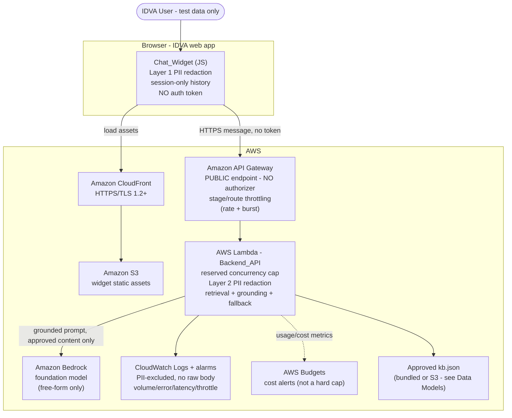
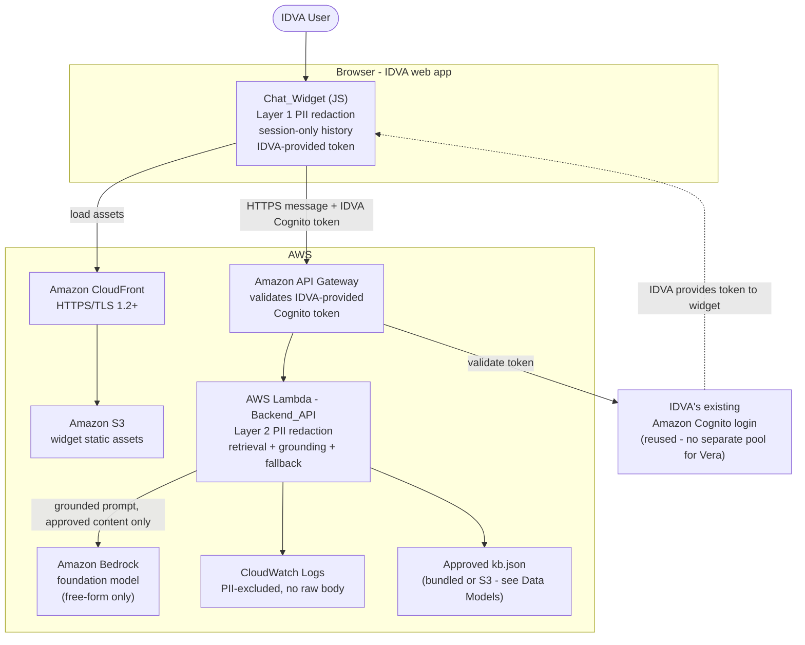

# Design Document

## Overview

Vera is a lightweight, serverless virtual assistant (FAQ chatbot) embedded in the Identity Document Verification Application (IDVA). It answers general questions about document uploads, photo checks, the AI quality check, verification steps, status meanings, common errors, and troubleshooting, strictly from an approved JSON knowledge base (`kb.json`). Vera never looks up an individual User's personal application or verification data.

The design realizes the approved requirements with a JavaScript `Chat_Widget` hosted in Amazon S3 and delivered via Amazon CloudFront, calling a `Backend_API` fronted by Amazon API Gateway and implemented in AWS Lambda. Predefined and clarify-flow questions are answered deterministically from approved content; only free-form questions that do not match a predefined entry are sent to an Amazon Bedrock foundation model, and only ever grounded on approved content retrieved from the knowledge base. Chat history lives only in the browser for the current Session; nothing conversational is persisted server-side. PII is protected by two independent redaction layers, and operational logs exclude PII and never include the raw request body.

This design deliberately separates two classes of guarantees:

- **Deterministic invariants (hard guarantees):** enforced by Vera's own code regardless of model behavior. Examples: no draft/pending/dangling knowledge-base content is ever placed in a Bedrock prompt; Bedrock is not invoked when no approved content is found; the server independently re-screens every message before any logging, retrieval, or Bedrock call; the raw request body is never logged.
- **Best-effort behaviors (reduce risk, with safe fallback):** PII detection and grounding of generated answers. These are pattern/heuristic and model-dependent, so they can have false negatives/positives. Vera reduces risk through defense-in-depth and prefers a privacy-safe or no-answer `Fallback_Response` whenever confidence is insufficient. Vera does **not** claim perfect PII detection or guaranteed elimination of unsupported model output.

### Implementation Stack

The implementation language of each component is an engineering choice layered on the architecture below; it does not alter any functional, security, privacy, or architectural guarantee in this design.

- **Backend_API (AWS Lambda):** C# on **.NET 10**, deployed on the AWS Lambda **managed `dotnet10` runtime** (Amazon Linux 2023), verified available. A container-image deployment is the documented fallback only if the managed runtime is unavailable in the target region.
- **Chat_Widget:** TypeScript (compiled to browser JavaScript), unchanged by the backend migration.
- **Infrastructure as code:** TypeScript using the **AWS CDK**.
- **Shared contract:** the `{ sessionId, message }` → `{ reply, isFallback, sourceFaqId?, kbVersion }` wire contract is defined once and mirrored as TypeScript types (for the widget) and C# records/DTOs (for the backend). The on-the-wire JSON contract is identical across languages, so the widget is unaffected by the backend language.
- **Testing:** the backend uses **xUnit + FsCheck** (property-based) to prove the correctness properties; the widget uses Vitest + fast-check. The backend is C#/.NET 10 only — there is no TypeScript backend in the final architecture.

### Research Summary / Key Findings

- **Real knowledge-base shape (`kb.json`).** The approved file uses these top-level keys: `kbVersion` (string version identifier used wherever a KB version is referenced), `lastUpdated`, `uiLabels` (string[]), `messages` (canned user-facing copy), `clarifyFlows` (deterministic decision trees), `photoIssues` (per-issue remediation), `statements` (grounding corpus), and `faqs` (matchable Q&A). The design consumes these fields as-is; `kb.json` is not modified.
- **Canonical copy lives in `messages`.** All fallback, PII, clarify, small-talk, and error strings are sourced from `messages.*` rather than invented. `messages.fallback` is `"I'm sorry, I don't have enough information to answer that. Please contact DDS support for further assistance."` This resolves the open support-channel item to **DDS support**.
- **Most interactions need no model.** `clarifyFlows` and `photoIssues` are fully deterministic (normalization plus keyword/synonym matching against `match[]`, and in-memory map lookups). Bedrock is only needed for free-form questions that do not directly match a predefined `FAQ_Entry`.
- **Eligibility is a filtering problem, not a retrieval-scale problem.** Many entries are `draft`/`pending` or have `directAnswer: null`. These must be excluded. The hard rule: an entry is eligible only if `status == "active"` AND `review == "team-confirmed"`, and a FAQ is directly answerable only if `directAnswer != null`.
- **KB size does not warrant a vector store.** At this corpus size, a vector DB / OpenSearch / embeddings stack is not warranted. A lightweight in-memory keyword/synonym matcher loaded once per Lambda cold start is the recommended baseline, kept behind an interface so the relevance strategy is swappable. Only scoring/threshold tuning remains open: `[CONFIRM: relevance-matching approach and threshold — to be decided in design]`.
- **Authentication is phased; IDVA is currently a POC.** IDVA is currently a proof of concept (POC): Amazon Cognito is **not** configured yet and IDVA currently has **no** authentication.
  - **Phase 1 (current POC) — no authentication.** Vera runs without Cognito. API Gateway does **not** require a Cognito authorizer, so the Backend_API endpoint must be treated as **publicly callable** unless separately restricted. The POC is protected by **compensating controls** — API Gateway stage/route-level throttling, Lambda reserved concurrency, CloudWatch monitoring/alarms, and AWS Budgets alerts — and it uses **test data only** (no real/production PII). These controls are not authentication, do not guarantee a hard spending cap, and do not prevent direct (non-browser) calls; the two-layer PII redaction still applies to whatever is sent.
  - **Phase 2 (future authenticated deployment) — reuse IDVA's future Cognito.** When IDVA implements Amazon Cognito authentication, Vera **reuses IDVA's existing login and tokens** — there is **no separate Cognito user pool for Vera** and users do **not** need a second login. IDVA securely provides the appropriate token to the embedded Vera widget, and API Gateway validates that token before invoking Lambda. The exact token-sharing mechanism and authorizer type are decided when Cognito is implemented (`[CONFIRM: ...]`).

## Architecture

Vera is a serverless, client-plus-API system. The widget runs in the User's browser inside IDVA; the backend is stateless Lambda behind API Gateway; Bedrock is invoked only on the free-form path over approved content.

### System Context

Authentication is phased. IDVA is currently a POC with **no** authentication (Phase 1); Cognito arrives later (Phase 2). The two diagrams below show each phase.

**Phase 1 (current POC) — no Cognito, public endpoint protected by compensating controls:**



**Phase 2 (future) — API Gateway validates an IDVA-provided Cognito token before invoking Lambda (reused login, no separate pool):**



### Request Flow

The authorizer decision step (node D) is **Phase 2 only** — shown dashed/optional. In **Phase 1 (POC)** there is no authorizer: the request passes through API Gateway stage/route throttling and goes straight to Layer 2 redaction. The transmit step is marked "Phase 1: no token / Phase 2: + IDVA Cognito token."

```mermaid
flowchart TD
    A[User submits message in Chat_Widget] --> B[Layer 1: widget redacts DOB/DL/SSN\nto placeholders before display + transmit]
    B --> C[POST over HTTPS/TLS 1.2+ to API Gateway\nPhase 1: no token / Phase 2: + IDVA Cognito token\nAPI Gateway stage/route throttling in front]
    C -.->|Phase 2 only| D{Authorizer: IDVA-provided\nCognito token valid?}
    D -. no .-> D1[Phase 2: Reject without processing message]
    D -. yes .-> E
    C ==>|Phase 1: no authorizer| E[Layer 2: Lambda independently re-screens\nand redacts BEFORE any logging/retrieval/Bedrock]
    E --> F{Sensitive_Value safely removable?}
    F -- no --> F1[Return privacy-safe Fallback_Response\nno log/process/Bedrock of unsafe content]
    E --> G[Log entry: session id, timestamp, kbVersion\nNO raw request body, NO PII]
    G --> H{Direct FAQ match\n(active + team-confirmed + directAnswer != null)?}
    H -- yes --> H1[Return directAnswer + FAQ id + kbVersion]
    H -- no --> I{Clarify flow / photo-issue match?}
    I -- yes --> I1[Deterministic: validate referenced ids,\nreturn inline answer / faq / photoIssue]
    I -- no --> J{Retrieval finds relevant approved content?}
    J -- no --> J1[Return Fallback_Response\nBedrock NOT invoked]
    J -- yes --> K[Build Bedrock prompt from approved\ncontent only; instruct no-answer signal]
    K --> L{Model returns no-answer signal?}
    L -- yes --> J1
    L -- no --> M[Return grounded answer\n+ FAQ_Entry id + kbVersion]
```

### Architectural Decisions and Rationale

- **S3 + CloudFront for the widget (Req 1, 2):** managed, globally cached, HTTPS/TLS 1.2+ delivery; widget load failure surfaces an error or omits the widget without blocking the host page.
- **API Gateway + Lambda for the backend (Req 2, 3, 11):** stateless, auto-scaling, no server management. The Lambda is implemented in **C# on .NET 10** using the AWS Lambda **managed `dotnet10` runtime** (Amazon Linux 2023); a container image is the fallback only if the managed runtime is unavailable in the target region. Request authorization is enforced at the gateway **only in Phase 2** (API Gateway validates an IDVA-provided Cognito token before Lambda). In **Phase 1 (POC)** there is no authorizer and the endpoint is public (see Phase 1 POC security considerations below).
- **Bedrock only on the free-form path (Req 5, 6):** deterministic paths cover predefined questions, clarify flows, and photo issues with no model cost or hallucination risk; the model is a fallback for interpretation, always grounded on approved content.
- **Two independent redaction layers (Req 7):** client redaction improves UX and reduces exposure, but the server never trusts it and always re-screens.
- **In-memory eligible KB per cold start (Req 4, 6, 9):** load once, filter to approved content, prune dangling references; keeps latency low and keeps the relevance layer swappable.

### Phase 1 POC security considerations

IDVA is currently a proof of concept with **no authentication**, and Amazon Cognito is not configured yet. In Phase 1 the Backend_API endpoint is **publicly callable** unless separately restricted; nothing in Phase 1 authenticates the end user. This must be treated as a real security consideration, not something authentication protects. Phase 1 therefore relies on **compensating controls** and **test data only** (no real/production PII). The two-layer PII redaction still applies to whatever is sent.

**Baseline Phase 1 compensating controls (primary):**

1. **API Gateway stage/route-level throttling** — steady-state rate limits plus burst limits configured at the stage/route (not dependent on usage plans), to bound request rate against a public endpoint.
2. **Lambda reserved concurrency** — caps backend fan-out and concurrent executions to limit cost and blast radius.
3. **CloudWatch monitoring** — metrics and alarms on request volume, errors, latency, throttles, and Bedrock usage.
4. **AWS Budgets** — budget with alerts for cost.

**Optional additional controls (NOT baseline):**

- **Usage plans + API keys** — applicable only with a compatible REST API configuration; present as optional, not baseline. **API keys are NOT authentication** — they identify/meter a caller, they do not authenticate the end user.
- `[CONFIRM: optional POC restriction — AWS WAF rules]`
- `[CONFIRM: optional POC restriction — IP allow-list]`
- None of these optional controls provide authentication.

**Important clarifications (do not over-claim protection):**

- **No hard spending cap.** Throttling bounds request rate and reserved concurrency bounds fan-out, but spend can still accrue; AWS Budgets **alerts/notifies** and is not an absolute cost ceiling. Neither mechanism guarantees a hard dollar limit.
- **CORS is not authorization.** CORS is a **browser** restriction; it does not prevent non-browser/direct calls to a public endpoint and provides no API authorization.
- **Usage-plan quotas do not automatically protect a public endpoint**; they are optional and configuration-dependent.

In **Phase 2**, API Gateway validates an IDVA-provided Cognito token before invoking Lambda (reused IDVA login, no separate pool), and these compensating controls become secondary to real authentication.

### Knowledge-base source vs. runtime location

The authored, approved `kb.json` has a **local development source / authoring location on a developer machine only**: `D:\WWW\vera\knowledge\kb.json`. This absolute Windows path is **not** a runtime path and nothing in the running system loads it. At deploy time the `Deployment_Process` validates the file against its JSON schema (Req 9) and packages/publishes the validated file to a runtime-appropriate location, which the Lambda references via configuration (for example an environment variable or config value), never an absolute developer path. `[CONFIRM: runtime KB location — bundled with Lambda artifact vs. S3 object]`

## Components and Interfaces

### Chat_Widget (browser, JavaScript)

Responsibilities (Req 1, 2, 7, 8):

- Render an accessible open control and the Conversation for the current Session; show the submitted message and a "preparing a response" indicator; render the returned response. Conform to WCAG 2.1 Level AA for the widget interface. (Full WCAG conformance requires manual testing with assistive technologies and expert review.)
- **Layer 1 PII redaction:** before a message is added to visible history and before transmission, detect DOB / driver's license number / SSN patterns and replace each with `[REDACTED_DOB]`, `[REDACTED_LICENSE_NUMBER]`, `[REDACTED_SSN]`. Surface `messages.piiNotice`, the relevant `messages.piiReminder.*`, and `messages.maskingNotice`/`messages.piiRephrase` when redaction occurs.
- Call the Backend_API through API Gateway over HTTPS/TLS 1.2+. In **Phase 1 (POC)** the widget sends **no auth token** (IDVA has no authentication yet). In **Phase 2**, the widget forwards the IDVA-provided Cognito token (reused IDVA login, no separate pool for Vera). `[CONFIRM: Phase 2 token-sharing mechanism — how IDVA provides the Cognito token to the embedded Vera widget]`
- Retain Conversation history on the client for the current Session only; never persist it. On asset load failure, surface a load error or omit the widget without blocking the host page.

Interface (conceptual):

```
POST {apiBaseUrl}/message
// Phase 1 (POC): no Authorization header (IDVA has no auth yet)
// Phase 2: Authorization: <IDVA-provided Cognito token>  (reused IDVA login, no separate pool; mechanism to confirm)
Body: { sessionId: string, message: string }   // message already Layer-1 redacted
Response: {
  reply: string,
  isFallback: boolean,
  sourceFaqId?: string,        // present when answer is traceable to a FAQ_Entry
  kbVersion: string
}
```

### Backend_API (AWS Lambda behind API Gateway)

Pipeline per request (Req 3, 5, 6, 7, 10, 11, 12):

1. **Authorization** (gateway, phase-aware):
   - **Phase 1 (POC):** no authorizer. The endpoint is **public** and protected only by the Phase 1 compensating controls (API Gateway stage/route throttling, Lambda reserved concurrency, CloudWatch monitoring/alarms, AWS Budgets alerts) with test data only. This is not authentication and does not prevent direct calls.
   - **Phase 2:** API Gateway validates an IDVA-provided Cognito token (reused IDVA login, no separate pool for Vera) before invoking Lambda; otherwise the request is rejected without processing the message. `[CONFIRM: Phase 2 API Gateway authorizer type — native Cognito authorizer vs. Lambda/JWT authorizer]`
2. **Layer 2 PII redaction** (`PiiRedactor`): independently re-screen and redact before any logging, retrieval, or Bedrock request, regardless of any client claim. If a Sensitive_Value cannot be confidently/safely removed, return a privacy-safe `Fallback_Response` and do not log/process/transmit the unsafe content.
3. **Operational logging** (`Logger`): record session id, timestamp, and `kbVersion`; on fallback, record the reason. Exclude PII and the raw request body.
4. **Routing:** direct FAQ match → clarify-flow / photo-issue match → retrieval + grounded generation → fallback.

Sub-components:

- **KnowledgeBaseProvider** — loads the approved `kb.json` once per cold start, builds the eligible set and reference graph, prunes dangling/unapproved references, and exposes only approved content. Runtime guard re-checks eligibility on every access (defense-in-depth).
- **Retrieval_Component** (`Matcher` interface) — lightweight in-memory keyword/synonym matching over the filtered KB. Swappable implementation. `[CONFIRM: relevance-matching approach and threshold — to be decided in design]` (in-memory keyword/synonym is the recommended baseline; this confirm covers scoring/threshold tuning only).
- **ClarifyFlowEngine** — static deterministic navigation of `clarifyFlows`: normalize input, match against each option's `match[]`, follow `next` / `faq` / `answer`+`statementIds` / `issue`. Supports `freeText: true` options (e.g. `upload.error`). No Bedrock.
- **PhotoIssueResolver** — in-memory map lookup over `photoIssues` (reached via an `upload.checks` `issue` option or a matching failing-check phrase). No Bedrock.
- **Generation_Component** — invokes Bedrock only on the free-form path, with a prompt constrained to approved retrieved content and an instruction to emit a no-answer signal when unsupported.
- **Grounding_Component** — best-effort control: constrains generation to approved content and returns `Fallback_Response` on no-answer or when no relevant approved content exists. Does not claim to detect all unsupported output.
- **ReferenceValidator** — resolves and validates every referenced id for any answer-producing path (see Data Models → Reference Integrity).

### Deployment_Process (build/deploy pipeline, distinct from runtime)

Validates `kb.json` against its JSON schema at build and deploy time (Req 9); deploys only schema-valid files; on failure, rejects at deploy time and the previously deployed file remains in effect. The runtime Backend_API consumes the already-validated deployed file without re-running schema validation.

## Data Models

### Knowledge base (consumed as-is from `kb.json`, never modified)

Top-level keys: `kbVersion` (string version identifier), `lastUpdated`, `uiLabels` (string[]), `messages`, `clarifyFlows`, `photoIssues`, `statements`, `faqs`.

**messages** — canonical user-facing copy; Vera sources these strings and does not invent them. Keys used: `welcome`, `piiNotice`, `maskingNotice`, `fallback`, `tryAgainLater`, `clarify`, `piiRephrase`, `busy`, `networkError`, `unresolved`, `piiUploadGuidance`, `decline.{eligibility_decision, legal_advice, unconfirmed_detail}`, `piiReminder.{dl, ssn, dob, general}`, `smallTalk.{greeting, thanks, appreciation, acknowledgment, farewell}`, `clarifyRetry`.

**statement** (grounding corpus):

```
{ id: "ST-LQC-01", topic: "photo-checks",
  text: "Before anything is sent, IDVA runs four photo checks ...",
  status: "active", origin: "ui-screenshot",
  review: "team-confirmed", updated: "2026-10-16" }
```

**faq**:

```
{ id: "FAQ-UPL-02", topic: "formats", suggested: true,
  questions: ["What image formats are supported?", ...],
  statementIds: ["ST-UPL-03", "ST-UPL-04"],
  directAnswer: "Please upload a JPEG or PNG image.",
  status: "active", review: "team-confirmed", updated: "2026-10-16" }
```

Another real example, `FAQ-LQC-01` (topic `photo-checks`), maps to `ST-LQC-01`, `ST-LQC-02`, `ST-PRV-01` with a non-null `directAnswer`.

**clarifyFlow option** (deterministic; exactly one of `next` / `faq` / `answer`+`statementIds` / `issue`), real example from `upload.checks`:

```
{ id: "glare", label: "No glare on the card",
  match: ["no glare on the card", "glare", "reflection", ...],
  issue: "glare" }
// ... with an "unsure" option: { id: "unsure", ..., faq: "FAQ-LQC-03" }
```

**photoIssue** (keyed by `focus`/`glare`/`lighting`/`size`), real example `glare`:

```
{ answer: "If there's glare on the card, try taking another picture ...",
  statementIds: ["ST-LQC-01", "ST-TIP-03", "ST-TIP-01", "ST-LQC-04"],
  status: "active", origin: "team-decision",
  review: "team-confirmed", updated: "2026-10-18" }
```

### Eligibility (hard invariant)

An entry is **eligible** only if `status == "active"` AND `review == "team-confirmed"`. A FAQ is **directly answerable** only if additionally `directAnswer != null`. Draft/pending/null-answer content is excluded. Real excluded examples: FAQs `FAQ-UPL-06`, `FAQ-UPL-07`, `FAQ-AIQ-04`, `FAQ-RES-01`, `FAQ-RES-02`, `FAQ-REF-01`; statements `ST-UPL-06`, `ST-RES-01`, `ST-RES-02`, `ST-RES-03`. A question mapping only to excluded content returns `messages.fallback`. The eligible set is computed at load/deploy time with a runtime guard as defense-in-depth.

### Reference Integrity (across all answer-producing paths)

Answer-producing paths: (a) direct FAQ `directAnswer`; (b) `clarifyFlows` inline `answer` options; (c) `clarifyFlows` `faq`-id options; (d) `clarifyFlows` `issue` → `photoIssues` options; (e) `photoIssues` answers; (f) Bedrock retrieval over `statements`/`faqs`. For every path, each referenced id (FAQ id, `photoIssues` key, and every `statementId` referenced by FAQs / clarify-flow inline answers / photo issues) must resolve to an **existing eligible** entry. A reference is usable only if the target exists and is eligible (and `directAnswer != null` for direct FAQ answers). If a referenced id is missing (dangling), draft, pending, or unapproved, that reference is rejected or safely skipped (dropped); if pruning leaves no approved content for the path, the path returns `messages.fallback`. A `clarifyFlows` inline `answer` option is served only when all of its `statementIds` are eligible; otherwise it is skipped to fallback. The eligible graph is built and dangling/unapproved references pruned at load/deploy time, with a runtime guard as defense-in-depth. This is validation/filtering logic in Vera; `kb.json` is unchanged.

### PII placeholders

Replace detected Sensitive_Value occurrences with `[REDACTED_DOB]`, `[REDACTED_LICENSE_NUMBER]`, `[REDACTED_SSN]`. Detection is pattern/heuristic best-effort (see Error Handling). No raw PII is stored, logged, or sent to Bedrock.

### Session / Conversation

Conversation history is held client-side for the current Session only. The Lambda is stateless and persists no Conversation data. Transport is HTTPS/TLS 1.2+.

## Correctness Properties

*A property is a characteristic or behavior that should hold true across all valid executions of a system — essentially, a formal statement about what the system should do. Properties serve as the bridge between human-readable specifications and machine-verifiable correctness guarantees.*

The properties below are grouped into **deterministic invariants** (hard guarantees enforced by Vera's own code) and **best-effort behaviors** (risk-reducing controls that fall back safely when confidence is insufficient). Best-effort properties are deliberately worded so they do not assert perfect PII detection or guaranteed elimination of unsupported model output.

**Group A — Deterministic invariants (hard guarantees):** Properties 1–14 below are enforced by Vera's own code independent of model behavior.

### Property 1: Phase 2 — Authorization is required before any message processing

*For any* request to the Backend_API that does not carry a valid IDVA-provided Cognito token, the request is rejected and the message is never processed (no redaction, logging, retrieval, or Bedrock call occurs).

**Validates: Requirements 3.1, 3.2**

**Phase note:** This invariant holds only in **Phase 2** (authenticated deployment). In **Phase 1 (current POC)** it does **not** hold — the endpoint is public and there is no authentication. In Phase 1 this property is replaced by the compensating-control expectation: API Gateway stage/route throttling (rate + burst) and Lambda reserved concurrency bound request rate and fan-out, CloudWatch alarms surface anomalies, and AWS Budgets alerts track cost (with test data only). Phase 1 does not enforce authentication.

### Property 2: No per-user application or verification data is accessed

*For any* query, Vera produces its answer without accessing or retrieving any individual User's application or verification data.

**Validates: Requirements 3.3, 4.4**

### Property 3: Direct FAQ matches return the approved answer

*For any* eligible FAQ (active, team-confirmed, `directAnswer != null`) and any of its listed question variants, the Backend_API returns that FAQ's `directAnswer`.

**Validates: Requirements 4.1**

### Property 4: Generation is grounded only in approved retrieved content

*For any* invocation of the Generation_Component, the Bedrock prompt is constructed only from approved content returned by the Retrieval_Component and includes a no-answer instruction; no draft, pending, dangling, or otherwise unapproved content is ever placed in the prompt.

**Validates: Requirements 5.2, 6.2**

### Property 5: Bedrock is not invoked when no approved content is relevant

*For any* query for which the Retrieval_Component finds no relevant approved content, the Backend_API returns the Fallback_Response and the Generation_Component is never invoked.

**Validates: Requirements 6.1**

### Property 6: Reference integrity across all answer-producing paths

*For any* answer-producing path (direct FAQ answer, clarify-flow inline answer, clarify-flow FAQ-id option, clarify-flow issue → photoIssue, photoIssue answer, or Bedrock retrieval), every referenced id (FAQ id, photoIssues key, and every statementId) resolves to an existing eligible entry; dangling, draft, pending, or unapproved references are pruned or skipped, are never served to the User, and are never placed in a Bedrock prompt; when pruning leaves no approved content the path returns `messages.fallback`.

**Validates: Requirements 4.1, 5.2, 6.1, 6.2, 9.5**

### Property 7: Server independently re-screens before any sink

*For any* message received by the Backend_API, server-side PII screening and redaction run before any logging, FAQ retrieval or processing, or Bedrock request, regardless of whether the Chat_Widget claims to have redacted the message.

**Validates: Requirements 7.3, 7.4**

### Property 8: No raw PII or raw request body reaches a sink

*For any* message, operational log entries, Bedrock requests, and any stored data contain only descriptive placeholders for redacted values and never the original Sensitive_Value content, and the raw incoming request body is never written to logs.

**Validates: Requirements 7.7, 7.8, 10.3**

### Property 9: Redaction does not block answering the remainder

*For any* message from which one or more Sensitive_Value occurrences were redacted, the Backend_API still attempts to answer the remaining non-sensitive question from the approved FAQ content.

**Validates: Requirements 7.5**

### Property 10: Conversation data is not persisted server-side

*For any* request, no Conversation data is written to server-side persistent storage.

**Validates: Requirements 8.2**

### Property 11: Schema validation gates deployment; invalid files do not deploy

*For any* candidate FAQ_File submitted to the Deployment_Process, schema validation is performed, and if the file is schema-invalid it is rejected at deploy time and the previously deployed file remains in effect.

**Validates: Requirements 9.1, 9.2**

### Property 12: Answers are traceable to source

*For any* answer derived from a FAQ_Entry (direct or generated), the response carries the FAQ_Entry identifier and the `kbVersion`.

**Validates: Requirements 5.3, 9.5**

### Property 13: Operational log fields are present

*For any* processed message, the log entry contains the Session identifier, a timestamp, and the `kbVersion` used; when a Fallback_Response is returned, the log entry also records the fallback reason.

**Validates: Requirements 10.1, 10.2**

### Property 14: Graceful degradation produces a safe fallback

*For any* execution in which a free-form question is unsupported, the model returns a no-answer signal, the Retrieval_Component is unavailable, the Generation_Component is unavailable or times out, or an unexpected error occurs, the Backend_API returns the Fallback_Response; for unexpected errors the error is also recorded in the operational log.

**Validates: Requirements 5.4, 6.3, 12.1, 12.2, 12.3**

**Group B — Best-effort behaviors (risk reduction with safe fallback):** Properties 15–16 below reduce risk and fall back safely when confidence is insufficient; they do not assert perfect detection.

### Property 15: Detected Sensitive_Value content is placeholder-redacted at the widget

*For any* message in which the widget's pattern/heuristic detector identifies a date of birth, driver's license number, or Social Security number, each detected occurrence is replaced with its placeholder (`[REDACTED_DOB]`, `[REDACTED_LICENSE_NUMBER]`, `[REDACTED_SSN]`) before the message is added to visible history and before transmission. This is best-effort detection and does not guarantee that every possible Sensitive_Value is detected.

**Validates: Requirements 7.1, 7.2**

### Property 16: Unsafe-to-remove content triggers a privacy-safe fallback

*For any* message where a Sensitive_Value cannot be confidently or safely removed, the Backend_API returns a privacy-safe Fallback_Response and does not log, process, or transmit the unsafe content to Bedrock. Because detection is heuristic, Vera prefers this safe fallback whenever confidence is insufficient rather than forwarding uncertain content.

**Validates: Requirements 7.6**

## Error Handling

- **Unauthenticated / invalid token (Req 3.1, 3.2 — phase-aware):** In **Phase 2**, the API Gateway authorizer validates the IDVA-provided Cognito token and rejects an unauthenticated/invalid-token request before the Lambda processes the message; no redaction, logging, retrieval, or Bedrock call occurs. In **Phase 1 (POC)** there is no authentication — the endpoint is public — so there is no token to reject; the POC relies on the compensating controls (API Gateway stage/route throttling, Lambda reserved concurrency, CloudWatch monitoring/alarms, AWS Budgets alerts) and test-data-only operation. Note these controls do not authenticate callers, do not guarantee a hard spending cap, and CORS does not prevent direct non-browser calls.
- **PII that cannot be safely removed (Req 7.6):** return a privacy-safe Fallback_Response sourced from `messages` (e.g. `messages.piiRephrase` when the message was mostly personal detail, otherwise `messages.fallback`); the unsafe content is not logged, processed, or sent to Bedrock. Detection is heuristic best-effort, so uncertainty resolves to the safe fallback.
- **No relevant approved content (Req 6.1):** return `messages.fallback`; do not invoke Bedrock.
- **Model no-answer signal (Req 6.3):** return `messages.fallback`.
- **Retrieval unavailable (Req 12.1):** return `messages.fallback` (surface `messages.tryAgainLater` where appropriate).
- **Generation unavailable or timeout (Req 12.2):** return `messages.fallback`. `[CONFIRM: generation timeout]`
- **Unexpected error (Req 12.3):** return `messages.fallback` and record the error in the operational log (no PII, no raw request body).
- **Widget asset load failure (Req 2.5):** surface a load error or omit the widget without blocking the host IDVA page. Transport/network failures surface `messages.networkError`; high load surfaces `messages.busy`.
- **Raw request-body logging prevention (Req 7.7, 10.3):** API Gateway and Lambda must not log the raw incoming request body — disable/avoid access logging of the request body, and ensure Layer 2 redaction runs before anything logs or otherwise persists message content, so raw DOB/DL/SSN cannot leak via request logging. Only placeholders and non-PII metadata (session id, timestamp, `kbVersion`, fallback reason) are logged.
- **Dangling / unapproved references (Req 5.2, 6.2, 9.5):** pruned at load/deploy and guarded at runtime; if a path is left with no approved content, return `messages.fallback`.

## Testing Strategy

Vera is tested with a practical combination of unit, property-based, integration, and security tests. Test types are chosen to fit each behavior rather than by a fixed rule; iteration counts for property tests are chosen pragmatically, and some properties are better covered by unit, integration, or security tests than by generated inputs.

### Priorities (highest-value coverage)

1. **PII leakage prevention** — including raw request-body logging: assert placeholders (never raw values) in logs, Bedrock prompts, stored data, and transmitted payloads; assert the raw request body is never logged.
2. **Authorization enforcement (phase-aware)** — Phase 2: unauthenticated/invalid-token requests are rejected without processing. Phase 1 (POC): no authentication — verify Vera functions without a token and that the Phase 1 compensating controls behave as configured (see Phase 1 tests below).
3. **Approved-content filtering and reference integrity** — only active + team-confirmed (and `directAnswer != null`) content is served; dangling/draft/pending references are pruned or skipped.
4. **Grounding** — Bedrock prompts contain only approved retrieved content; Bedrock is not invoked when no approved content exists.
5. **Fallback behavior** — unsupported, no-answer, unavailable, timeout, and error paths all return the correct `messages` fallback.

### Unit tests

Specific examples, edge cases, and canned-copy assertions: direct FAQ matching for real entries (e.g. `FAQ-UPL-02`, `FAQ-LQC-01`), clarify-flow navigation (e.g. `upload.checks` options including `unsure` → `FAQ-LQC-03`), photo-issue lookups (e.g. `glare`), fallback text equals `messages.fallback`, and that each excluded example (`FAQ-UPL-06`, `FAQ-UPL-07`, `FAQ-AIQ-04`, `FAQ-RES-01`, `FAQ-RES-02`, `FAQ-REF-01`, `ST-UPL-06`, `ST-RES-01`, `ST-RES-02`, `ST-RES-03`) is never served.

### Property-based tests

Property-based testing is one useful tool here (for example, fast-check for JS/TypeScript or Hypothesis for Python). Generators should cover edge cases and **KB mutations** (injecting dangling ids, flipping entries to draft/pending, nulling `directAnswer`, and inserting DOB/DL/SSN patterns in free text). Property-based testing suits the deterministic invariants above — reference integrity (Property 6), redaction ordering and no-leak (Properties 7, 8), grounding/prompt construction (Properties 4, 5), and fallback coverage (Property 14). A tag such as `Feature: vera-virtual-assistant, Property {n}` may be used as optional guidance; it is not required, and there is no mandate of exactly one property test per property or a fixed 100-iteration count.

### Integration tests

CloudFront delivery and TLS policy, API Gateway → Lambda wiring, deploy-then-query (Req 9.3), latency against the confirmed target (Req 11.1), and availability monitoring (Req 12.4). **Phase 2:** authorizer validation of an IDVA-provided Cognito token (reused IDVA login, no separate pool). Use representative examples rather than high-volume generation for external-service behavior.

**Phase 1 (POC) tests** — the current POC has no authentication:
- Verify the function responds correctly **without** any auth token (public endpoint).
- Verify **API Gateway stage/route throttling** behavior (steady-state rate + burst limits) — requests beyond the limit are throttled.
- Verify the **Lambda reserved-concurrency** cap bounds concurrent executions.
- Verify **CloudWatch alarms** fire on the configured conditions (request volume, errors, latency, throttles, Bedrock usage).
- Verify **AWS Budgets** alerting is configured and notifies on threshold.
- Explicitly acknowledge the endpoint is **public**; assert that **API keys (if used) are not treated as authentication** and that **CORS is not authorization** (a non-browser/direct call still reaches the endpoint).
- Use **no real data** (test data only); the two-layer PII redaction still applies and is exercised.

### Security tests

Explicit adversarial cases:
- **Bypass client redaction:** send a request body containing raw DOB/DL/SSN with a "client already redacted" claim; assert Layer 2 still redacts and nothing raw reaches logs/Bedrock/storage.
- **Dangling / unapproved id injection:** mutate the KB (or craft routing) to reference missing/draft/pending ids; assert references are pruned/skipped and never appear in output or a Bedrock prompt, with fallback when empty.
- **Unauthenticated / invalid-token requests (Phase 2):** assert rejection without processing. In Phase 1 there is no authentication to assert; instead treat the public endpoint as in scope for the compensating-control checks above.
- **Prompt-elicitation attempts:** inputs crafted to elicit ungrounded answers; assert the model is constrained to approved content and that unsupported requests resolve to fallback (best-effort grounding with safe fallback, not a guarantee of perfect detection).

### Accessibility testing

Automated a11y scans for the widget plus documented manual testing with assistive technologies; full WCAG 2.1 AA conformance requires manual testing and expert review and is not asserted by automated checks alone (Req 1.5).

## Design Decisions / Open Questions

### Resolved

- **Identity / authentication (two-phase).** IDVA is currently a **POC** with no authentication and no Amazon Cognito configured. (Req 3 is a **Phase 2** target; see traceability note below.)
  - **Phase 1 (current POC):** **no authentication.** API Gateway does not require a Cognito authorizer, so the Backend_API endpoint is **public** unless separately restricted. Protected by compensating controls (API Gateway stage/route throttling, Lambda reserved concurrency, CloudWatch monitoring/alarms, AWS Budgets alerts) and **test data only**. These controls are not authentication, do not guarantee a hard spending cap, and CORS is not authorization.
  - **Phase 2 (future):** IDVA implements Cognito; Vera **reuses IDVA's existing login and tokens** — **no separate Cognito user pool for Vera**, no second login for users. IDVA securely provides the token to the embedded Vera widget, and **API Gateway validates the token before invoking Lambda**.

  **Requirement 3 traceability (phased):** Requirement 3 (authenticated access) is a **Phase 2** target. In **Phase 1** it is **not satisfied** — the endpoint is treated as public — and is compensated by the Phase 1 throttling/monitoring/cost controls with test-data-only operation. Traceability to Req 3 is retained and reframed as phased, not deleted.
- **Support channel:** **DDS support**, as expressed in `messages.fallback` and related `messages` copy. This resolves the prior support-channel open item. (Req 6.4)
- **Relevance baseline:** lightweight in-memory keyword/synonym matching over the filtered KB, loaded once per cold start; a vector DB / OpenSearch / embeddings stack is not warranted at this KB size. The matcher sits behind a swappable interface. (Req 6.1)
- **User-facing copy source:** all fallback/PII/clarify/small-talk/error strings are sourced from `messages.*` in `kb.json`, not invented.
- **Eligibility rule:** active + team-confirmed (and `directAnswer != null` for direct answers); everything else excluded.

### Open — require confirmation

- `[CONFIRM: Phase 2 token-sharing mechanism — how IDVA provides the Cognito token to the embedded Vera widget]`
- `[CONFIRM: Phase 2 API Gateway authorizer type — native Cognito authorizer vs. Lambda/JWT authorizer]`
- `[CONFIRM: relevance-matching approach and threshold — to be decided in design]` — scoring/threshold tuning only; in-memory keyword/synonym is the recommended baseline.
- `[CONFIRM: runtime KB location — bundled with Lambda artifact vs. S3 object]` — the runtime loads from a configured location, never the absolute developer path `D:\WWW\vera\knowledge\kb.json`.
- `[CONFIRM: latency target]` (Req 11.1)
- `[CONFIRM: generation timeout]` (Req 12.2)
- `[CONFIRM: availability target]` (Req 12.4)

### Honest limits

- **PII detection is best-effort.** Pattern/heuristic detection for DOB, driver's license number, and SSN can produce false negatives and false positives. Vera relies on defense-in-depth (two independent layers, not logging raw request bodies, minimizing what is sent to Bedrock) and on safe fallback when confidence is insufficient. Vera does not claim to catch every Sensitive_Value.
- **Grounding is best-effort risk reduction.** Restricting generation to approved content, instructing a no-answer signal, and falling back when unsupported reduce the risk of unsupported answers but do not guarantee detection of all hallucinated or unsupported model output. The deterministic invariants (no draft/pending/dangling content in a prompt, no Bedrock call without approved content, server-side re-screening before any sink, raw body never logged) remain hard guarantees independent of model behavior.
